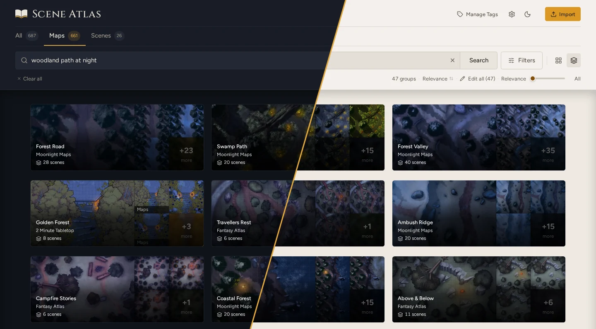

<p align="center">
  <picture>
    <source media="(prefers-color-scheme: dark)" srcset="assets/brand/lockup-dark.png">
    
  </picture>
</p>

<p align="center"><strong>Art and map management for game masters.</strong></p>

<p align="center">
  <a href="https://jennis0.github.io/scene-atlas/">Website</a> ·
  <a href="#download">Download</a> ·
  <a href="https://jennis0.github.io/scene-atlas/guide/what-is-scene-atlas">Guide</a> ·
  <a href="#self-hosting">Self-hosting</a> ·
  <a href="CONTRIBUTING.md">Contributing</a>
</p>

Scene Atlas keeps your battlemaps and scene art in one place and helps you find the right one fast. Describe the map you need, like "flooded crypt" or "market square at dusk", and it finds it by what's in the image, not what the file is called. Drop in the folders and zips from your map downloads and it groups the variants and detects the grid.

Free and open source. Runs as a desktop app on Windows, macOS and Linux, or self-hosted on your own server. All data remains entirely local to your machine.



<sub>Searching "woodland path at night". Maps by <a href="https://www.moonlight-maps.com">Moonlight Maps</a> (CC BY-NC-SA 4.0), <a href="https://2minutetabletop.com">2-Minute Tabletop</a> (CC BY-NC 4.0) and <a href="https://www.patreon.com/fantasy_atlas">Fantasy Atlas</a> (CC BY-NC 4.0). Support them on Patreon! This screenshot is shared under CC BY-NC-SA 4.0.</sub>

## Features

- **Search by content, not filename:** describe what you're looking for and get the maps that match. You can also search by name, creator or tag.
- **Import whole collections:** folders and zip files straight from your downloads, with duplicates skipped.
- **Variants together:** the day, night, winter and gridless versions of a map stay grouped as one.
- **Animated maps:** MP4 and WebM maps are imported, searched and played alongside the rest.
- **Grid detection:** square and hex grids found on battlemaps, so you know the grid before it goes into your VTT.
- **Filters:** by type, grid, colour and tags, with tag packs for fantasy, sci-fi, horror, cyberpunk and historical games.
- **Handles big libraries:** tested with over 56,000 images.

## Download

Get the installer for your system from [Releases](https://github.com/jennis0/scene-atlas/releases).

| System | Download |
|---|---|
| Windows 10 or later | `.exe` installer (x64) |
| macOS 13 or later | `.dmg`, Apple Silicon only |
| Linux | `.AppImage` or `.deb` (x64) |

The installers aren't signed yet, so Windows and macOS warn you the first time you open Scene Atlas: [how to open it anyway](https://jennis0.github.io/scene-atlas/deploy/desktop#first-launch-warnings). You'll need 8 GB of RAM, 16 GB recommended.

> No release has been published yet. Until the first one, run Scene Atlas [from source](https://jennis0.github.io/scene-atlas/development/building).

## Self-hosting

Run Scene Atlas on your own server to reach your library from anywhere:

```bash
git clone https://github.com/jennis0/scene-atlas.git
cd scene-atlas
docker compose --profile cpu up -d     # --profile gpu for an NVIDIA GPU
```

Then open http://localhost:8000. Scene Atlas has no sign-in of its own, so put it behind a reverse proxy that handles sign-in before you open it up beyond your own network. See [Docker server](https://jennis0.github.io/scene-atlas/deploy/server).

## Documentation

- **Using it:** [getting started](https://jennis0.github.io/scene-atlas/guide/getting-started), [importing](https://jennis0.github.io/scene-atlas/guide/importing), [searching](https://jennis0.github.io/scene-atlas/guide/searching), [groups](https://jennis0.github.io/scene-atlas/guide/groups), [tags](https://jennis0.github.io/scene-atlas/guide/tags)
- **Installing it:** [desktop app](https://jennis0.github.io/scene-atlas/deploy/desktop), [Docker server](https://jennis0.github.io/scene-atlas/deploy/server), [standalone server](https://jennis0.github.io/scene-atlas/deploy/standalone), [configuration](https://jennis0.github.io/scene-atlas/deploy/configuration)

## Contributing

Bug reports and pull requests are welcome. [CONTRIBUTING.md](CONTRIBUTING.md) covers setting up a development environment, and [design/](design/README.md) explains how Scene Atlas is built.

## Licence

MIT. See [LICENSE](LICENSE). The Cinzel and Figtree fonts are under the SIL Open Font License.
